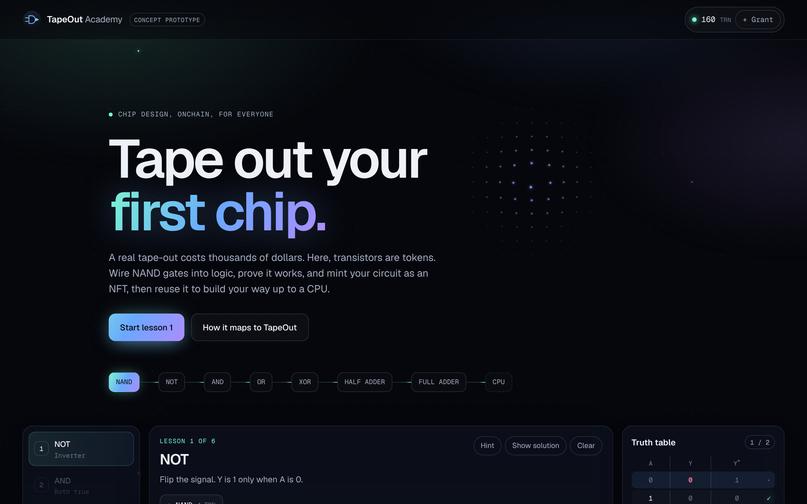
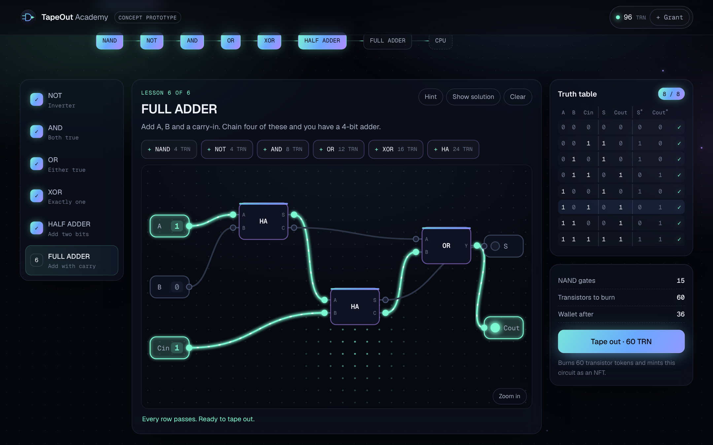
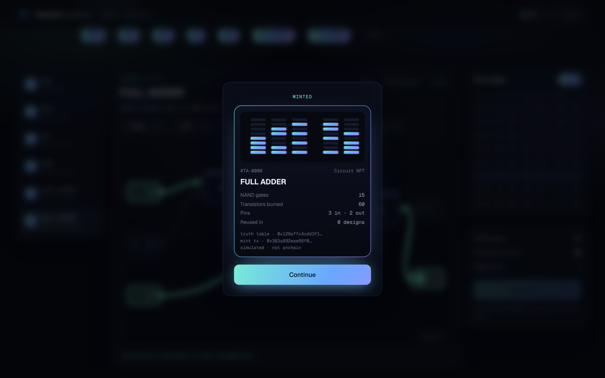
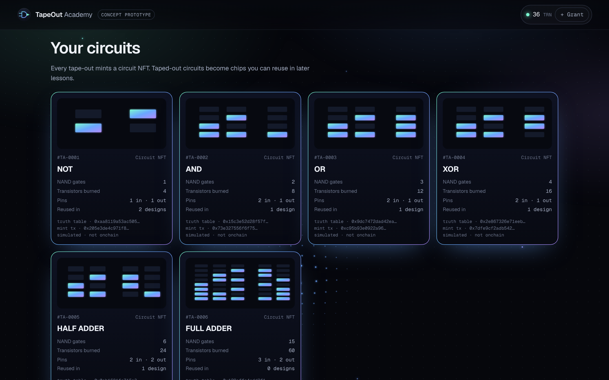
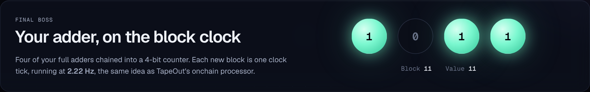
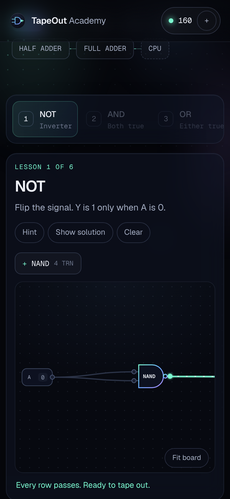

  

<h1 align="center">TapeOut Academy</h1>

<b>Tape out your first chip.</b> 
A concept chip-design school for the TapeOut ecosystem.

<a href="https://tapeout-academy.vercel.app"><b>▶ Try the live prototype</b></a>

  

A real chip tape-out costs thousands of dollars. TapeOut turns transistors into tokens, which makes chip design something anyone can try for pocket change. TapeOut Academy is a prototype of what a school built on that idea could look like: students wire NAND gates into logic, prove it with a truth table, then tape it out. That burns transistor tokens and mints the circuit as an NFT. Every circuit they tape out becomes a reusable chip for the next lesson, so they climb from a single NAND gate to a working adder running on a block clock.

> **Community concept prototype.** Not affiliated with TapeOut. Everything runs in the browser: no wallet, no chain, no real tokens.

## Screenshots

**Build circuits from NAND gates.** Tap an output pin, then an input pin, to wire. Live signals glow, and the truth table checks every row as you build.

**Tape out.** Burns transistor tokens and mints the circuit as an NFT. The card art is the circuit's own truth table.

**Your circuits.** Every taped-out circuit becomes a chip you can reuse, with a "Reused in" counter as a hook for designer royalties.

**Final boss: the block clock.** Four of your full adders chained into a 4-bit counter that ticks at 2.22 Hz, the same idea as TapeOut's processor clocked by block production.

**Works on phones.** The board zooms in and you drag empty space to pan.

## Lessons

| # | Circuit | Built from | NAND gates | Transistors |
|---|---|---|---|---|
| 1 | NOT | NAND | 1 | 4 |
| 2 | AND | NAND + NOT | 2 | 8 |
| 3 | OR | NOT + NAND | 3 | 12 |
| 4 | XOR | 4 × NAND | 4 | 16 |
| 5 | Half adder | XOR + AND | 6 | 24 |
| 6 | Full adder | 2 × half adder + OR | 15 | 60 |

Each lesson has a hint and a "Show solution" button. Lessons unlock in order, because each one uses the chips you taped out before it.

## How it maps to TapeOut

| Prototype | TapeOut (as publicly described) |
|---|---|
| TRN wallet balance | Transistor tokens (ERC-1155) |
| Tape out: burn TRN, mint a card | Tape-out consumes transistors and mints the circuit as an ERC-721 |
| Taped-out circuits in the parts palette | Composable circuit NFTs |
| Block clock lesson | Processor clocked by block production |

## Where the TapeOut team could take it

- Replace the simulated wallet with a real wallet on X Layer / BNB Chain and call the actual tape-out contract.
- Issue finished lessons as onchain credentials: proof that someone designed a working adder.
- Pay royalties to designers whose circuits get reused in other tape-outs.
- Add sequential lessons (latches, registers) and climb all the way to the CPU.

## Run it

Live at **https://tapeout-academy.vercel.app**. Static site, no build step and no dependencies: open `index.html` in a browser, or import the repo into Vercel and deploy as-is.

| File | What's in it |
|---|---|
| `app.js` | Lessons, circuit simulator, board editor, tape-out flow, NFT cards, block clock, dot field |
| `style.css` | Theme, glass panels, glow effects, responsive layout |
| `logo.svg` | Logo and favicon |
| `docs/screenshots/` | Images used in this README |

Progress is saved in your browser. Use **Reset progress** in the footer to start over.
